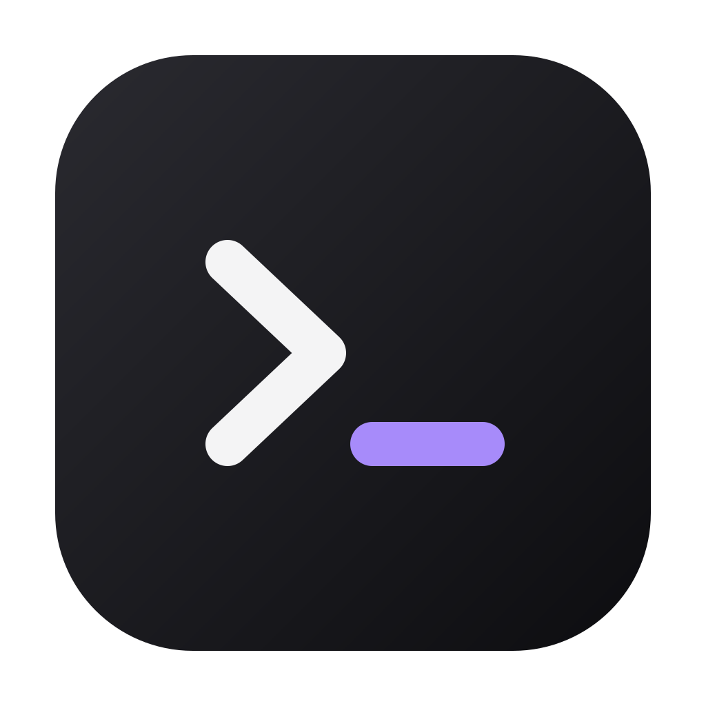
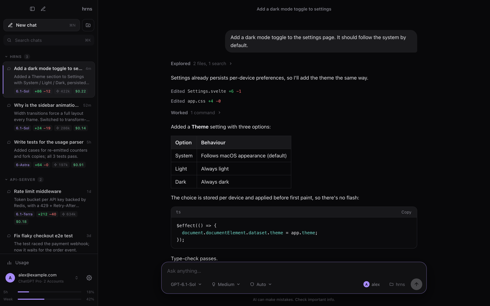
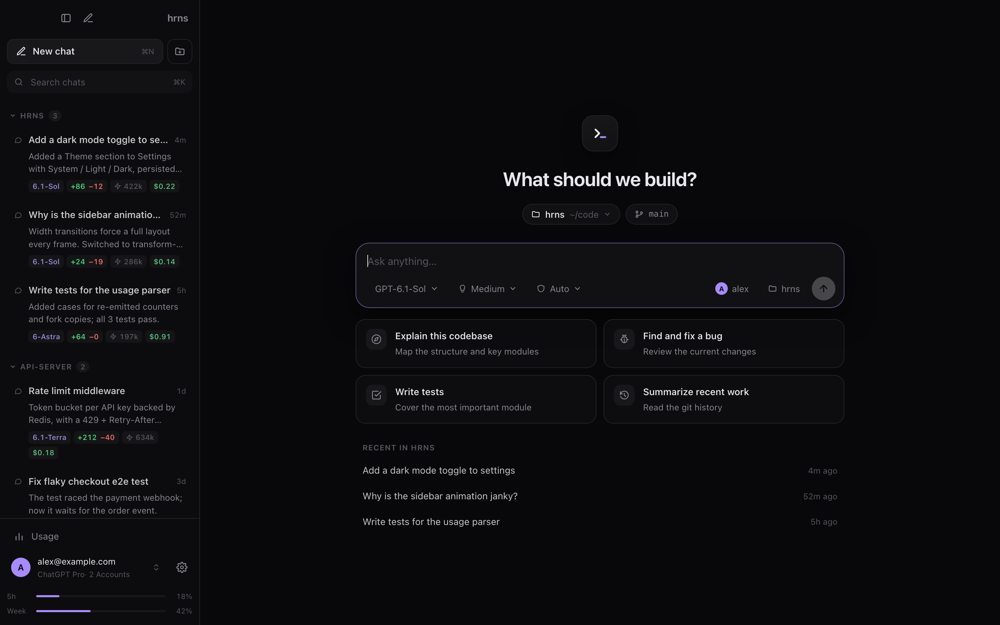
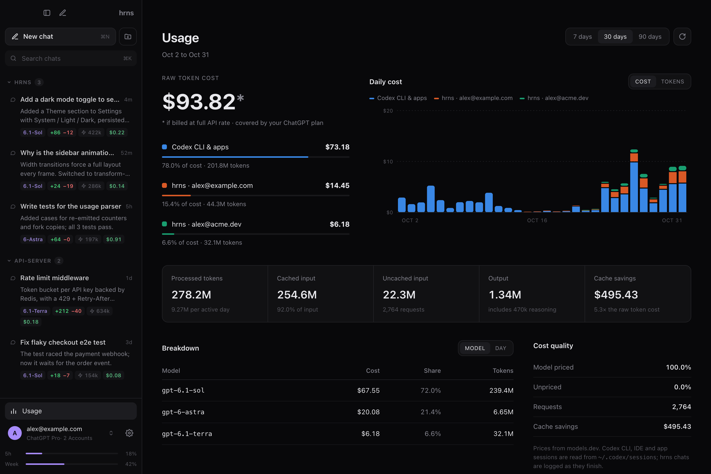
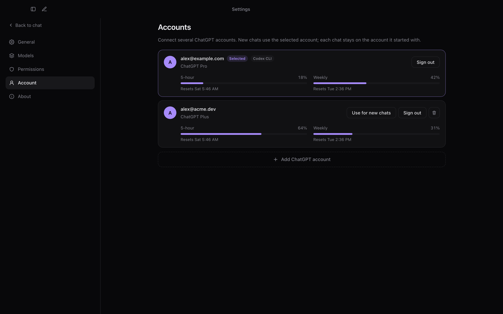
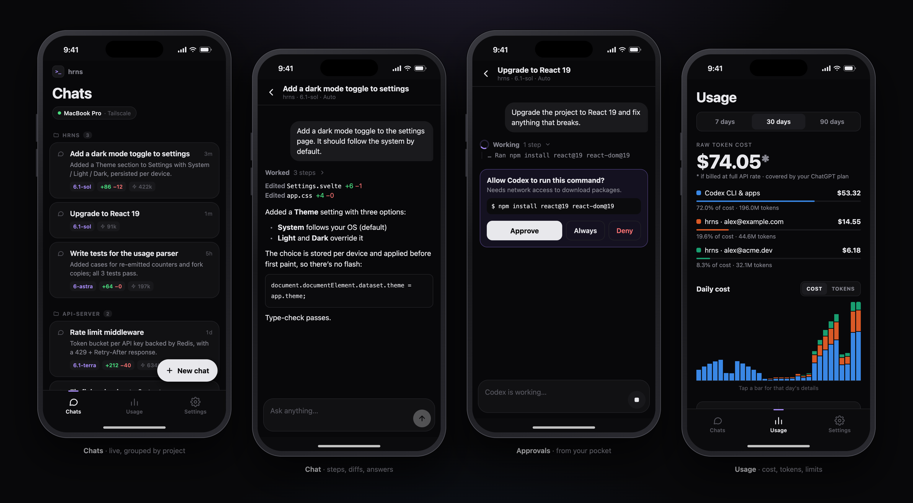

<div align="center">



# hrns

**A fast, battery-friendly desktop app for Codex — built in Rust.**

Chat with OpenAI's Codex agent using your ChatGPT subscription, with a clean Codex/T3-style interface,
multiple accounts, live command & diff views, and a usage dashboard.

[Features](#features) · [Screenshots](#screenshots) · [Getting started](#getting-started) · [How it works](#how-it-works) · [Privacy](#privacy)

</div>

---



## Features

- **Your ChatGPT subscription, no API key.** hrns drives the official `codex app-server`, the same backend the Codex CLI and IDE extensions use, so chats run on your ChatGPT plan.
- **The real Codex agent.** Same agent instructions, your `~/.codex/config.toml`, MCP servers, skills and `AGENTS.md`.
- **Projects & permissions.** Every chat runs in a project folder. Choose **Read only**, **Auto** (edit inside the project, ask for anything else) or **Full access**, just like Codex.
- **Readable agent activity.** Steps collapse into one line (`Explored 4 files, 2 searches`). Commands show as *Read*, *Listed*, *Searched* or *Ran*, with output in a terminal panel. Edits show `+12 −3` and a colored diff.
- **Approvals.** When Codex wants to go outside the sandbox you get an inline card: *Approve*, *Approve for this chat* or *Deny* (⌘↵ to approve).
- **Multiple ChatGPT accounts.** Connect several accounts, pick one per chat, and run chats on different accounts at the same time. Each account shows its 5-hour and weekly limits.
- **Usage dashboard.** Daily cost and tokens, by source, model and day, with cache savings. It covers hrns chats *and* your Codex CLI/IDE/app sessions.
- **Rich session list.** Chats are grouped by project, each showing its status, a preview, the model, `+/−` lines, tokens and an estimated cost. Click a chat's badges for a details menu.
- **Model & reasoning picker,** loaded live from Codex.
- **Remote control from your phone.** A companion React Native (Expo) app connects over **Tailscale**. You can browse every chat, watch Codex work live, send prompts, stop turns, approve commands, start new chats, and check usage and account limits. Approvals and finished turns also show up as notifications, with **Approve / Deny** buttons.

## Screenshots

| New chat | Usage |
|---|---|
|  |  |

| Accounts |
|---|
|  |

<sub>Screenshots use demo data.</sub>

## Getting started

### Requirements

- **macOS** (developed and tested on Apple Silicon; Linux and Windows are untested)
- **[Codex CLI](https://github.com/openai/codex)**, installed and signed in with ChatGPT:
  ```sh
  npm i -g @openai/codex
  codex login
  ```
- **[Rust](https://rustup.rs)** (stable) and **[Bun](https://bun.sh)** (or Node.js) to build

### Run from source

```sh
git clone https://github.com/GhaythBenAbid/hrns.git
cd hrns
bun install
bun tauri dev        # development, with hot reload
bun tauri build      # optimized .app + .dmg in src-tauri/target/release/bundle
```

If you aren't signed in to Codex yet, hrns shows a **Sign in with ChatGPT** button. You can add more accounts later in **Settings → Accounts**.

### Phone app (remote control)



The phone app lives in [`mobile/`](mobile) and connects to hrns on your Mac over [Tailscale](https://tailscale.com).

1. Install Tailscale on your **Mac and phone**, and sign in to the same tailnet on both.
2. In hrns, open **Settings → Remote** and turn it on. A pairing QR code appears.
3. Run the app with Expo:
   ```sh
   cd mobile
   npm install
   REACT_NATIVE_PACKAGER_HOSTNAME=$(tailscale ip -4) npx expo start --lan
   ```
4. Scan Expo's QR code with **Expo Go**, then tap **Scan pairing code** in the app and point it at the QR code in hrns.

**Security:** the remote server listens **only on your Tailscale address** (never on `0.0.0.0` and never through Funnel). Every request needs the pairing token, which the phone keeps in the system keystore. Use **Reset** in Settings → Remote to unpair every phone.

<sub>Expo Go shows notifications while the app is open or recently in the background. Push notifications that reach a closed app need a development build with Firebase.</sub>

### Keyboard shortcuts

| | |
|---|---|
| New chat | <kbd>⌘</kbd> <kbd>N</kbd> |
| Search chats | <kbd>⌘</kbd> <kbd>K</kbd> |
| Toggle sidebar | <kbd>⌘</kbd> <kbd>B</kbd> |
| Settings | <kbd>⌘</kbd> <kbd>,</kbd> |
| Approve request | <kbd>⌘</kbd> <kbd>↵</kbd> |
| Stop response / close page | <kbd>Esc</kbd> |

## How it works

```
┌──────────────────────── hrns (Tauri) ─────────────────────────┐
│  Svelte UI  ── IPC ──▶  Rust core                              │
│  (system WebView)        ├─ per-account Codex engine ──stdio──▶ codex app-server
│                          ├─ chat store (JSON per thread)       │      (one per account,
│                          ├─ usage ledger + transcript scanner  │       started lazily)
│                          └─ models.dev price cache             │
└────────────────────────────────────────────────────────────────┘
```

- **UI:** Svelte 5 rendered by the system WebView (Tauri 2), so there's no bundled Chromium.
- **Core:** Rust. It speaks JSON-RPC to `codex app-server` over stdio, keeps chat history locally, and streams events to the UI.
- **Accounts:** one `CODEX_HOME` per extra account. Each home links to your real config, so only the login differs.

### Built to sip battery

- No polling anywhere. Everything is event-driven from the Codex process.
- Codex processes start **on first use** and shut down after **10 minutes idle**.
- Streaming text reaches the screen at most every 60 ms, and history is written once per turn, never per token.
- The sidebar animates with GPU transforms only, never layout.
- The usage scan reads only the new bytes of each session log, so a 600 MB history takes about 1 s the first time and about 15 ms after that.
- If `codex` is the npm wrapper, hrns runs the bundled native binary directly, so no Node.js process stays alive.

### How usage is counted

hrns uses the same approach as [T3 Code](https://github.com/pingdotgg/t3code):

- **Codex CLI / IDE / app:** reads `token_count` events from `~/.codex/sessions/**/rollout-*.jsonl`. Codex's cumulative counters are used to count each request once, and the copies of history that forked sessions start with are skipped.
- **hrns chats** (no transcript is written) are logged when each turn finishes.
- **Cost** is an estimate at public API prices from [models.dev](https://models.dev), cached locally and refreshed only when an unknown model appears. Your ChatGPT plan already covers this usage; the number shows what the same work would cost through the API.

## Privacy

Everything stays on your machine. Chats, usage and prices are stored in `~/Library/Application Support/dev.hrns.app`. hrns makes no network requests of its own except one download of the [models.dev](https://models.dev) price catalog. Talking to OpenAI is done by Codex itself.

## Project layout

```
src/                 Svelte UI (App, Sidebar, Composer, Usage, Settings…)
src-tauri/src/
  codex.rs           Codex app-server client: turns, streaming, approvals, idle shutdown
  accounts.rs        multiple ChatGPT accounts (one CODEX_HOME each)
  usage.rs           usage ledger + incremental transcript scanner (with tests)
  pricing.rs         models.dev price cache
  remote.rs          Tailscale-only HTTP + WebSocket API for the phone app
  store.rs           local chat history
mobile/              React Native (Expo) remote-control app
  App.tsx            pairing, live connection, tabs, notifications
  src/screens/       Pair · Chats · Chat · Usage · Settings
```

Run the Rust tests with `cd src-tauri && cargo test`.

## Roadmap

- [x] Phone remote control over Tailscale
- [ ] Push notifications when the phone app is closed (dev build + FCM)
- [ ] opencode as a second engine (any provider/model)
- [ ] Move a chat to another account mid-conversation
- [ ] Image attachments
- [ ] Light theme polish

## License

[MIT](LICENSE). hrns is an independent project and isn't affiliated with OpenAI or T3.
